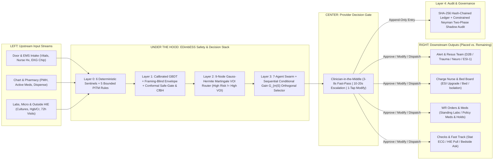

# EDimbESS — UX Optimization & Statistical Safety Engine Handoff Document

**System:** `EDimbESS` (Emergency Department Imbalanced Evaluation & Statistical Safety Engine for Provider-in-the-Middle Triage & 3D Spatial XR)  
**Repository:** https://github.com/deesatzed/EDimbESS.git · Local Workspace: [EDimbESS](file:///Volumes/WS4TB/EDimbESS)  
**Status:** Functional End-to-End Prototype (`v0.1.0`, `11/11` verification tests passing, `0` UI detector warnings, SHA-256 audited)

> [!IMPORTANT]
> **Research & Teaching Prototype Only (Zero PHI):** `EDimbESS` operates strictly on synthetic `syn-ED-###` packets (`syn-ED-001` through `syn-ED-022`). Patient names, dates of birth, MRNs, SSNs, addresses, phone numbers, and emails are rejected before entering memory at `/api/intake`. Not for live clinical care, paging, or EHR write-back.

---

## 1. Purpose of This Handoff

Emergency Department (ED) **Provider-in-the-Middle (PITM)** triage places an attending physician or advanced practice provider (APP) at the operational crossroads **immediately after nurse door intake** and **before** patients are roomed or placed on the waiting-room board.

In real clinical practice, PITM providers face two simultaneous failure modes:
1. **Cognitive Overload & Alert Fatigue:** Opening 6–10 EHR tabs per arrival (prior ED notes, microbiology cultures, pharmacy dispense history, outside HIE feeds, baseline labs/echoes) takes 2–4 minutes per patient—impossible when 15–30 arrivals stack up per hour—while naive clinical decision support floods the screen with repetitive low-PPV alerts (`>70%` false alarms) and raw risk scores that do not state *what action changes*.
2. **Premature Closure & Concealed Chart Threats:** Subtle vital-sign trajectories, minimizing triage framing, active blood thinners omitted at the door, unreviewed resistant cultures (`ESBL`), or deceptively benign high-pressure/ocular mechanisms look "routine" (`ESI-3` / `ESI-4`) on a 1-line triage note while carrying catastrophic downside if sent to an unmonitored waiting room.

**Goal for Collaborators & Reviewers:**  
We are seeking **UX, human-factors, clinical workflow, and 2D/3D spatial interaction ideas** to make the PITM experience **faster, calmer, more intuitive, and higher-throughput** for a busy ED clinician—while preserving every deterministic safety guardrail and `imbESS` statistical guarantee documented below.

---

## 2. End-to-End System Architecture & PITM Topology

The defining architectural principle of `EDimbESS` is **Provider-in-the-Middle Topology**: the clinician sits structurally and visually in the center with **Upstream Inputs** permanently visible on the left and **Downstream Outputs & Remaining Tasks** permanently visible on the right—even when `0` outputs have been placed by the provider so far.

### Codebase Module Map
- [contracts.py](file:///Volumes/WS4TB/EDimbESS/src/edimbess/contracts.py) — Immutable `PITMDecisionContract` definitions, capacity-adjusted thresholds, leak-free SHA-256 4-way patient-group `SplitProtocol`, Wilson intervals, Kish Effective Sample Size (`ESS`), Base-Rate Evidence Deficit $D_q(x)$, Holm–Bonferroni, Benjamini–Hochberg, and Nadeau–Bengio / Schuirmann TOST equivalence.
- [sentinels_and_rules.py](file:///Volumes/WS4TB/EDimbESS/src/edimbess/sentinels_and_rules.py) — Zero-PHI intake gate, negation-safe `affirmed_text`, EKG status-only rule, all 6 deterministic Must-Know Sentinels, the 5 bounded PITM decision engines, one-way output validator `validate_delta_output`, and 22 benchmark synthetic encounters (`syn-ED-001`..`syn-ED-022`).
- [calibration_cohort.py](file:///Volumes/WS4TB/EDimbESS/src/edimbess/calibration_cohort.py) — Train-only `TabularPreprocessor` with explicit missingness indicators, Newton-stabilized (`max_delta_step=1.0`) LightGBM, natural-prevalence monotonic `PlattLogitCalibrator`, and shared feature mapping (`packet_to_feature_frames`) across $N=5{,}600$ synthetic calibration encounters and live `syn-ED-###` packets.
- [two_phase.py](file:///Volumes/WS4TB/EDimbESS/src/edimbess/two_phase.py) — Water-filling constrained Neyman pilot allocation (`15%` chart-audit budget), untruncated Horvitz–Thompson sequential conditional log-likelihood gain $\hat{G}_{m \mid X_{\text{base}}, \mathcal{S}_{t-1}}$ from fixed Phase-1 logit offsets, exact $\widehat{V}_{\text{I}} + \widehat{V}_{\text{II}}$ two-phase variance decomposition, Holm LCB stopping, and live shadow-ledger auditing.
- [orthogonal_delta.py](file:///Volumes/WS4TB/EDimbESS/src/edimbess/orthogonal_delta.py) — 7-agent clinical chart-delta pipeline, 9-axis sequential conditional mechanism selector (`<= 3` findings, `<= 3` ask-next questions, zero baseline echoes, zero collinear twins), and 6-cell Satz-EM `SPOT DR` cognitive checklist.
- [streaming_safety.py](file:///Volumes/WS4TB/EDimbESS/src/edimbess/streaming_safety.py) — Dual Stage-1 framing-blind risk envelope, Dual Conformal Safe-Gate, tie-smoothed Jin & Candès (2023) `CfBH` conformal FDR control, 9-node Gauss–Hermite martingale VOI router, and zero-jargon `_build_clinical_routing_summary`.
- [server.py](file:///Volumes/WS4TB/EDimbESS/src/edimbess/server.py), [index.html](file:///Volumes/WS4TB/EDimbESS/web/index.html), [styles.css](file:///Volumes/WS4TB/EDimbESS/web/styles.css), [app.js](file:///Volumes/WS4TB/EDimbESS/web/app.js) — HTTP REST + SHA-256 ledger server, 3-column 2D PITM Crossroads desk, Three.js (`three@0.184.0`) 3D Spatial XR cockpit, and dedicated Statistical Engine workbench.

---

## 3. Clinical Decision Model & Layer 0 Deterministic Guardrails

Before any machine-learning model or statistical threshold executes, `EDimbESS` enforces **Layer 0 Deterministic Clinical Guardrails**. Statistical models **may never** suppress, filter, or downgrade a Layer 0 clinical rule.

### 3.1 The Five Bounded PITM Decisions & Cost Contracts ($\mathcal{K}_d$)

The PITM provider does **not** perform a full H&P or write inpatient admission orders at triage. Instead, the role is strictly bounded to **five operational decisions**, each governed by an explicit asymmetric cost contract $\mathcal{K}_d = (C_{\text{FP},d}, C_{\text{FN},d}, q_{\text{target},d}, c_{\text{query},d}, \alpha_{\text{FOR},d})$ with induced Bayes optimal action threshold:

$$\tau^*_d = \frac{C_{\text{FP},d}}{C_{\text{FP},d} + C_{\text{FN},d}}$$

| # | Decision (`decision_type`) | Allowed Action Space | $C_{\text{FP}} : C_{\text{FN}}$ | Bayes $\tau^*_d$ | Target PPV $q_{\text{target}}$ (`FDR`) | Safe-Pass $\alpha_{\text{FOR}}$ | Hard Operational Boundary |
| :--- | :--- | :--- | :---: | :---: | :---: | :---: | :--- |
| **1** | **Triage Acuity** (`triage_status`) | `ESI-1` .. `ESI-5` | `1 : 24` | `4.0%` (`0.0400`) | `35%` (`0.65`) | `5.0%` | Never downgrades nurse-charted ESI when active risk is present. |
| **2** | **Arrival Door Eval** (`eval_upgrade`) | `trauma`, `neuro`, `d2b`, or `[]` | `1 : 40` | `2.4%` (`0.0244`) | `40%` (`0.60`) | `2.5%` | Fires **strictly** when an indicated arrival evaluation is marked `"missing"` (never duplicates `"done"`). |
| **3** | **Treatment Space** (`space_priority`) | `immediate`, `next_bed`, `bed`, `hallway`, `fast_track`, `waiting_room`, `defer` | `1 : 15` | `6.25%` (`9.3%` at `3/18` beds) | `35%` (`0.65`) | `5.0%` | `ESI-1` / `STEMI` / missing `D2B` always claim `immediate` resus bay even when staffed beds are `0/18`. |
| **4** | **Waiting-Room Orders** (`wr_orders`) | `start`, `addon`, or `none` across 12 complaint sets | `1 : 8` | `11.1%` (`0.1111`) | `30%` (`0.70`) | `8.0%` | Deduplicated against orders already placed at door; **EKG is strictly forbidden here**. |
| **5** | **WR Policy Meds** (`wr_meds`) | `APAP`, `Ibuprofen`, `Ondansetron`, `Calcium carbonate`, or `[]` | `1 : 18` | `5.26%` (`0.0526`) | `35%` (`0.65`) | `4.0%` | Enforces hepatic, renal/transplant, anticoagulant/bleed, chest/abdominal, age $\ge 65$, and shock/NPO holds. |

#### Dynamic Crowding Adaptation (`capacity_adjusted_space_threshold`)
When staffed ED beds tighten (`bedsOpen` out of `bedsTotal`), occupying the last open bed with a borderline routine arrival carries higher opportunity cost. For `space_priority` on non-resuscitation arrivals, the effective false-positive cost scales smoothly with scarcity $s = 1 - \frac{\max(0, \text{bedsOpen})}{\max(1, \text{bedsTotal})}$:

$$C_{\text{FP,eff}} = C_{\text{FP}} \cdot (1 + 0.65 s), \qquad \tau^*_{\text{space}}(s) = \frac{C_{\text{FP,eff}}}{C_{\text{FP,eff}} + C_{\text{FN}}}$$

At `3/18` beds open ($s = 0.833$), $\tau^*_{\text{space}}$ shifts from `6.25%` to `9.3%`, routing stable low-risk arrivals to `Fast Track` or `Waitboard` while **never** blocking `immediate` resuscitation on `ESI-1`, shock, or `D2B` STEMI.

### 3.2 Critical Workflow Invariants (Domain Error Traps Eliminated)

1. **EKG Status-Only Boundary (`ekg_chip_for`):**  
   In ED operations, a 12-lead ECG is a rapid door screening procedure, not a lab-draw waiting-room order set. `EDimbESS` renders ECG strictly as a status badge (`EKG done`, `EKG pending`, `EKG N/A`). If an indicated complaint (`chest pain`, `syncope`, `dyspnea`, `epigastric`, `dizziness/fatigue`) arrives with `ekg.status == "missing"`, the system:
   - Blocks 1-pinch routine fast-pass, and
   - Surfaces a 1-tap nursing check button (`Flag Nurse: Stat Triage ECG`, `req_ekg`) rather than silently burying an ECG inside lab orders.
2. **Negation-Safe Symptom Parsing (`affirmed_text`):**  
   Triage notes routinely contain negative review-of-systems strings (`"Lightheaded since morning. No chest pain. Denies syncope or blood thinners."`). Naive keyword matching triggers false chest-pain order sets and false NSAID holds. `affirmed_text` strips negated clauses (`no`, `not`, `denies`, `denied`, `without`, `negative for`, `free of`) up to clause boundaries **after** replacing `"not breathing"` with a protected token (`¬breathing`), ensuring apnea is always detected while negated symptoms are ignored.
3. **Deterministic Medication Contraindication Matrix:**
   - **Global NPO / Hemodynamic Hold:** Zero oral WR meds if `proposed_esi == "ESI-1"`, `SBP < 90`, `GCS < 15`, or `HIGH_RISK_MECHANISM_ACTIVITY` (operative hand/ocular/spine emergency).
   - **Acetaminophen (`APAP`) Hold:** Held automatically on `cirrhosis`, `hepatic/liver failure`, `alcoholic` history, or if already administered at triage.
   - **Ibuprofen (`NSAID`) Hold:** Held automatically on affirmed chest pain, abdominal/epigastric/flank pain, `CKD` / `CRI` / `dialysis` / `transplant` / reduced `eGFR`, active anticoagulants/antiplatelets or GI bleed context, age $\ge 65$, or prior administration.

### 3.3 The Six Non-Waivable Must-Know Clinical Sentinels

`detect_must_know_sentinels` scans both the arrival encounter and longitudinal chart dossier for six high-hazard clinical categories, tagging whether each sentinel was already disclosed in the nurse triage note (`in_nurse_note: bool`) or **concealed in the chart**:

1. **`IMMUNOCOMPROMISED`** (`immunosuppression_occult_sepsis`): Calcineurin/mTOR inhibitors (`tacrolimus`, `cyclosporine`, `sirolimus`), antimetabolites (`mycophenolate`, `azathioprine`, `methotrexate`), biologics (`rituximab`, `infliximab`, `adalimumab`), systemic steroids, active chemo/neutropenia, HIV/AIDS, asplenia, or transplant history. Escalates to `critical` if `Temp >= 37.8°C` or `HR >= 105`.
2. **`ANTICOAGULATED_COAGULOPATHIC`** (`coagulopathy_hemorrhage`): DOACs (`apixaban`, `rivaroxaban`, `dabigatran`, `edoxaban`), `warfarin`, heparins, potent antiplatelets (`clopidogrel`, `prasugrel`, `ticagrelor`), uremic/dialysis platelet dysfunction, cirrhosis/alcohol coagulopathy, hemophilia/vWD, or prior `INR >= 1.5`. Escalates to `critical` when concealed (`not in_nurse_note`) in a trauma/fall/neuro/bleed presentation (e.g., `syn-ED-022`).
3. **`UNEXPLAINED_ABNORMAL_VS`** (`hemodynamic_instability`): Single-point instability (`SBP < 95`, `HR >= 100` or `<= 50`, `SpO2 < 94%`, `RR >= 22`, `Temp >= 38.0°C` or `< 36.0°C`, `GCS < 15`) **plus** serial trajectory deterioration across `prior_vitals` (`rising/repeated HR >= 100`, `SBP drop >= 8 mmHg`, `persistent bradycardia <= 50`, `declining GCS`).
4. **`HIGH_RISK_MECHANISM_ACTIVITY`** (`surgical_compartment_ocular`): Deceptively minor surface complaints masking limb-, vision-, or life-threatening mechanisms: high-pressure hydraulic/paint/grease injection to finger/hand (`syn-ED-018`), high-speed metal-grinding ocular projectile (`syn-ED-019`), `IVDU` with back pain/fever (`syn-ED-017` spinal epidural abscess risk), fall from height, or high-speed/ejected MVC (`syn-ED-007`).
5. **`HIGH_RISK_PMH`** (`glycemic_renal_electrolyte`): Solid-organ or bone-marrow transplant (**even if allograft was surgically removed**, e.g., `syn-ED-020`), `CKD` / `ESRD` / `Creatinine >= 1.5` / `eGFR <= 40`, severe HFrEF (`EF < 35%`), prior `CPR` / cardiac arrest / `AICD`, prior `intubation`, or known aortic aneurysm (`AAA`).
6. **`BOUNCEBACK_FREQUENT_ED`** (`bounceback_trajectory`): Any short-interval ED return (`today`, `yesterday`, `1–5 days`, or hours ago) or `>= 3` recent ED visits—guarding against diagnostic anchoring on the prior discharge diagnosis.

---

## 4. Granular Breakdown of All `imbESS` Components & Decision-Model Techniques

`EDimbESS` adapts and extends the `imboreceipt` statistical framework specifically for **imbalanced, cost-asymmetric, multi-channel streaming clinical triage** (natural serious-escalation prevalence $\pi \approx 12.43\%$ overall, dropping below $1.5\%$ in low-acuity strata). Every mathematical component solves a concrete clinical failure mode.

> [!NOTE]
> **Strict UI Separation Principle:** None of the Greek symbols, log-likelihood ratios, Horvitz–Thompson weights, or conformal $p$-values below ever appear on the **PITM Crossroads (2D)** or **3D Spatial XR** clinician tabs. They run silently under the hood to govern button states, queue ordering, and named check prompts, while remaining 100% inspectable in Tab 3 (**Statistical Engine**) and the **Audit Receipt** dialog.

### 4.1 Leak-Free SHA-256 4-Way Patient-Group Split & Informative-Missingness Preprocessor
- **Why Standard Splits Leak in ED Data:** Repeat bounceback visits by the same patient share baseline comorbidities, medications, and recent cultures. Row-level random splits leak patient identity across train, calibration, and test sets, causing overconfident calibration and invalid conformal coverage.
- **Implementation (`freeze_split` & `TabularPreprocessor`):**
  - Partitions patients (grouped by `patient_id` and stratified on any-positive encounter outcome) into four strictly disjoint sets **before** any statistics are computed: `train (55%, n=3,114)` / `cal (15%, n=835)` / `val (15%, n=814)` / `test (15%, n=837)`, sealed by a deterministic SHA-256 `split_hash` (`b0eaa72b...`).
  - `TabularPreprocessor` fits medians, scalers, ordinal/one-hot encoders, and **explicit binary missingness indicators (`miss__{col}`)** strictly on `X_train`. In ED triage, missingness (e.g., disconnected outside HIE, no prior labs on file) carries clinical signal and is never silently erased by median imputation.

### 4.2 Natural-Prevalence Newton-Stabilized GBDT & Monotonic Platt Calibration
- **Why SMOTE & Class Reweighting Are Prohibited:** Oversampling positives (SMOTE) or setting `class_weight="balanced"` shifts predicted probabilities from true clinical prevalence $\pi$ toward $0.50$. That destroys the operational meaning of Bayes threshold $\tau^* = 0.040$, invalidates expected loss integrals in Value-of-Information routing, and breaks False-Omission Rate (`FOR`) calibration.
- **Newton-Step Stabilization (`max_delta_step = 1.0`):** In gradient-boosted trees under class imbalance, second-order Newton leaf updates $-\frac{\sum_{i \in L} g_i}{\sum_{i \in L} p_i(1-p_i) + \lambda}$ become erratic when leaf probabilities $p_i \to 0$ (small denominators $p_i(1-p_i)$). Constraining `max_delta_step=1.0` alongside `num_leaves=23`, `min_child_samples=18`, `reg_alpha=0.5`, and `reg_lambda=3.0` prevents extreme logit jumps on sparse strata.
- **Out-of-Sample Monotonic Platt Calibration (`PlattLogitCalibrator`):** Fitted strictly on natural-prevalence held-out $\mathcal{D}_{\text{cal}}$ via logit-space logistic regression $\hat{p}_{\text{cal}}(x) = \operatorname{expit}\!\big(\beta_0 + \beta_1 \operatorname{logit}(\hat{p}_{\text{raw}}(x))\big)$, gated on monotonicity ($\beta_1 > 0$).
  - **Verified Held-Out Test Performance:** Stage-1 Door `AUROC = 0.8488` $\to$ Stage-2 Full Chart `AUROC = 0.9059`, Quantile-Binned `ECE = 0.0150`, Brier `0.0719`.

### 4.3 Dual Framing-Blind Stage-1 Envelope & Base-Rate Evidence Deficit $D_q(x)$
- **Clinical Problem (Framing & Stigmatization Bias):** Subjective triage framing—such as minimizing language (`"mild wrist pain"`, `"frequent visitor"`, `"intoxicated"`) or an under-triaged `ESI-4` assignment—can anchor both humans and ML models trained on `charted_esi_num`.
- **Dual Model Envelope:** `EDimbESS` trains a parallel **Framing-Blind Objective Model** $p_{1,\text{blind}}(x)$ that drops `minimizing_framing_flag` and `charted_esi_num`, relying purely on objective physiology, age, arrival mode, complaint family, and trajectory deltas. Gatekeeping uses the conservative upper envelope:

$$s_{\text{cons}}(x) = \max\big(p_1(x),\, p_{1,\text{blind}}(x)\big)$$

  and records **Framing Divergence** $\Delta_{\text{frame}}(x) = \max\big(0,\, \operatorname{logit}(p_{1,\text{blind}}(x)) - \operatorname{logit}(p_1(x))\big)$ (in nats).
- **Base-Rate Evidence Deficit (`instance_evidence_deficit`):** Quantifies how many nats of positive log-likelihood-ratio evidence are still needed for an encounter at natural prevalence $\pi$ to clear target alert precision $q_{\text{target}}$:

$$D_q(x) = \max\big(0,\, \operatorname{logit}(q_{\text{target}}) - \operatorname{logit}(s_{\text{cons}}(x))\big)$$

### 4.4 Dual Conformal Safe-Gate (Finite-Sample Safe Fast-Pass Certification)
- **UX Question Answered:** *"Which arrivals can the PITM clinician safely clear in a single 1-pinch / Spacebar fast-pass without opening the chart?"*
- **Dual Calibration Criterion on $\mathcal{D}_{\text{cal}}$ (`_calibrate_safe_routine_cutoff`):** Searches candidate thresholds $\tau \le \tau^*_{\text{triage}}$ (`0.0400`) and selects the largest cutoff $\tau_{\text{safe}}$ satisfying **both** finite-sample guarantees simultaneously:
  1. **95% Wilson Score Upper Bound on False-Omission Rate (`FOR`):** Among calibration encounters with $s_{\text{cons}}(x) \le \tau$, let $k = \sum \mathbf{1}\{Y_i = 1\}$ and $n$ be the subset size ($n \ge 40$). The exact **Wilson (1927)** upper confidence bound must satisfy:
     $$\operatorname{UCB}_{0.95}\!\left(\widehat{\operatorname{FOR}}(\tau)\right) \le \alpha_{\text{FOR}} = 0.05$$
  2. **Positive-Class Conformal Miss $p$-Value Bound:** Testing compatibility of $\tau$ with true positive escalations $\mathcal{D}_{\text{cal}}^{+} = \{i \in \mathcal{D}_{\text{cal}} : Y_i = 1\}$:
     $$p_{\text{pos}}(\tau) = \frac{1 + \#\{i \in \mathcal{D}_{\text{cal}}^{+} : s_{\text{cons},i} \le \tau\}}{1 + |\mathcal{D}_{\text{cal}}^{+}|} \le \alpha_{\text{miss}} = 0.06$$
- **Three Resulting Clinical Gate States:**
  - `CERTIFIED_SAFE_ROUTINE` (*Safe Fast-Pass* — Green Primary Button): Requires `0` Layer-0 sentinels, `0` missing door evals, `0` chart-delta findings, complete indicated ECG/HIE, $s_{\text{cons}}(x) \le \tau_{\text{safe}} = 0.0268$, and $p_{\text{pos}}(x) \le 0.06$. **Realized Held-Out Test Result:** Certifies **`19.95%`** of arrivals at a realized False-Omission Rate of **`0.60%`** (95% Wilson CI `[0.11%, 3.31%]`, well below the `5.0%` ceiling).
  - `AMBIGUOUS_HOLD_VOI` (*Hold Fast-Pass · Missing Check or Sign-Off* — Amber/Primary): Pauses 1-pinch routine fast-pass and surfaces specific missing checks (`ECG`, `Outside HIE`, `Bedside Question`) or standing lab/med sign-off.
  - `SENTINEL_ESCALATION` (*Physician Escalation Review* — Crimson): Active sentinel, missing `Trauma/Neuro/D2B` eval, `CRITICAL` chart delta, or elevated risk ($s_{\text{cons}} \ge 1.35\tau^*$).

### 4.5 Tie-Smoothed Jin & Candès (2023) `CfBH` Conformal FDR Control vs. Naive Mondrian `{1}`
- **Why Naive Mondrian `{1}` Fails in Triage Queues:** A common conformal mistake is flagging every arrival whose positive-class conformity $p$-value $p_{\text{pos}}(x) > \alpha$ (`Mondrian {1}`). Under $\pi = 12.4\%$, even if a threshold rejects $80\%$ of negatives, the remaining $20\%$ of the $87.6\%$ negative majority overwhelms true positives. On our held-out test split, `Mondrian {1}` ($\alpha = 0.10$) flags `46.1%` of the entire ED queue with a **`73.3%` False Discovery Proportion (`PPV = 26.7%`)**—classic alert fatigue.
- **Exact Tie-Smoothed `CfBH` Implementation (`conformal_fdr_selection`):** Computes finite-sample conformal $p$-values against calibration **negatives** $\mathcal{D}_{\text{cal}}^{-}$:

$$p_{\text{conf},j} = \frac{1 + \#\{i \in \mathcal{D}_{\text{cal}}^{-} : S_i > S_j\} + U_j \cdot \#\{i \in \mathcal{D}_{\text{cal}}^{-} : S_i = S_j\}}{1 + |\mathcal{D}_{\text{cal}}^{-}|}, \qquad U_j \stackrel{\text{i.i.d.}}{\sim} \operatorname{Uniform}(0, 1)$$

  - **Critical Mathematical Invariant:** Tree ensembles produce heavy score ties ($n_{\text{eq}} > 0$). Unsmoothed ranks become conservative step functions, while multiplying $(1 + n_{\text{gt}} + n_{\text{eq}})$ by $U_j$ destroys super-uniformity. Multiplying **only** $n_{\text{eq}}$ by $U_j$ preserves exact finite-sample super-uniformity under the null while restoring power under ties, followed by Benjamini–Hochberg step-up selection at target FDR $q = 0.35$ (`target PPV = 65%`).
  - **Held-Out Test Result:** `CfBH` achieves **`32.1%` realized FDP (`67.9%` PPV)** vs. `Mondrian {1}` at **`73.3%` FDP**.

### 4.6 Martingale-Centered 9-Node Gauss–Hermite Decision-Flip VOI Router
- **Core Operational Theorem (`High Risk != High VOI`):**  
  Let $L^*(p) = \min\big(p C_{\text{FN}},\, (1 - p) C_{\text{FP}}\big)$ be the Bayes optimal expected loss at posterior $p$, with action $a(p) = \mathbf{1}\{p \ge \tau^*\}$. Under any coherent Bayesian update ($\mathbb{E}[p_2 \mid p_1] = p_1$), the expected Value of Information of acquiring a Stage-2 channel equals the expected threshold-crossing savings on **decision-flipped cases** (Proposition 1):

$$\operatorname{VOI}_{\mathcal{K}}(p_1) = L^*(p_1) - \mathbb{E}\big[L^*(p_2) \mid p_1\big] = (C_{\text{FP}} + C_{\text{FN}})\,\mathbb{E}\Big[|p_2 - \tau^*| \cdot \mathbf{1}\{a(p_1) \neq a(p_2)\} \;\Big|\; p_1\Big] \ge 0$$

  - **Implication for ED Workflow:** When an arrival is **already far above $\tau^*$** (e.g., `syn-ED-011` STEMI with $p_1 = 0.875$ or `syn-ED-008` shock with $p_1 = 0.812$), $\mathbf{1}\{a(p_1) \neq a(p_2)\} \approx 0 \implies \operatorname{VOI} = 0.000$. **Never delay resuscitation waiting on an external HIE query!** Conversely, when $p_1 \ll \tau^*$ (`syn-ED-014` ankle sprain, $p_1 = 0.0099$), $\operatorname{VOI} = 0.000$. Query budget is concentrated strictly in the ambiguous zone near $\tau^*$ where new information flips the clinical decision.
- **Exact Mean-Preserving Logit-Normal Quadrature (`solve_mean_preserving_logit_offset`, Proposition 2):**
  - `StreamingVOIRouter` learns empirical conditional update volatility $\hat{\sigma}_\Delta(p_1) = \operatorname{SD}\big(\operatorname{logit}(p_2) - \operatorname{logit}(p_1) \mid p_1 \in \text{bin}\big)$ on $\mathcal{D}_{\text{cal}}$ for each of the 6 Stage-2 channels (`ch_hie_outside`, `ch_dispense_pdmp`, `ch_micro_cultures`, `ch_recent_labs_di`, `ch_social_isolation`, `ch_bedside_ask_probe`).
  - Because $\operatorname{expit}(\cdot)$ is curved, a zero-mean logit shock $\operatorname{logit}(p_1) + \sigma \xi$ shifts $\mathbb{E}[p_2 \mid p_1] \neq p_1$, creating negative VOI bias! For each $p_1$ and $\sigma$, Newton–Raphson solves to $< 10^{-14}$ tolerance on 9 Gauss–Hermite nodes $(\xi_r, \omega_r)_{r=1}^9$ for the unique centering offset $\mu^*(p_1, \sigma)$ such that:

$$\sum_{r=1}^{9} \omega_r \, \operatorname{expit}\!\big(\operatorname{logit}(p_1) + \mu^*(p_1, \sigma) + \sigma \xi_r\big) = p_1$$

  - Guaranteeing $\widehat{\operatorname{VOI}}_{\mathcal{K}}(p_1) \ge 0$ identically without ad-hoc `[·]_+` clipping artifacts.
- **Observation-Aware Gating:** A channel is surfaced as an actionable check **only if** (a) it is genuinely **unobserved** on the current packet (never prompting to "fetch labs" on `syn-ED-002` when `Cr 0.9` and prior CT are already in the chart!), (b) `not already_above_tau`, and (c) $\widehat{\operatorname{VOI}}_m(p_1) > c_{\text{query},m}$.
- **Held-Out Vickers–Elkin Net Benefit Decomposition (`artifacts/safety_engine_audit.json`):**  
  At matched query rate (`57.3%`), `Martingale_VOI_Autonomous` achieves a **`21.7%` decision-flip rate** vs. **`11.5%`** for `Top_Risk_Heuristic`, yielding **`+7.18` vs. `+1.45` net true-positive-equivalent benefit per 1,000 arrivals** (**`+5.73` per 1,000 advantage**).

### 4.7 7-Agent Chart-Delta Pipeline & Sequential Conditional Gain ($\hat{G}_{m \mid X_{\text{base}}, \mathcal{S}_{t-1}}$) Orthogonal Synthesis
- **Why Unconstrained Multi-Agent Summaries Overwhelm Clinicians:** When 3–5 clinical agents inspect a complex chart, they routinely (1) echo facts already visible on the triage header (*triage echoes*), or (2) emit 3 variations of the same pathophysiological problem (*collinear twins*, e.g., `"on tacrolimus"` + `"on mycophenolate"` + `"prior renal transplant"`), crowding out independent lethal threats under a 3-bullet cognitive budget.
- **7-Agent Architecture (`run_edimbess_7agent_swarm`):**
  1. `01_triage_anomaly` — Vital-sign trajectories, missing `Trauma/Neuro/D2B` door evals, high-risk surgical/ocular mechanisms.
  2. `02_longitudinal` — Unreviewed microbiology (`ESBL`), severe hemoglobin/potassium/WBC deltas, `HIGH_RISK_PMH`, `<=72h` bouncebacks.
  3. `03_medication` — Active sulfonylurea hypoglycemia risk (`glipizide`), concealed anticoagulants (`CONFLICTING` evidence tag when omitted in nurse note), immunosuppressants.
  4. `04_disposition` — `MRSA` isolation room routing, frail/lives-alone barriers, and a **strictly digit-free `queue_note`** (qualitative flow guidance without raw census numbers that go stale).
  5. `05_safety_net` — Deduplicated immediate stabilization actions (`Point-of-care glucose now` with thiamine-before-dextrose check, `Sepsis lactate and blood cultures`, `Expedite noncontrast head CT`), verified against `triage_orders_placed`.
  6. `06_synthesizer` — Enforces hard cognitive caps (`findings <= 3`, `ask_patient <= 3`, `safety_net <= 3`) plus the 6-cell Satz-EM **`SPOT DR`** checklist (`Serious`, `Probable`, `Outside`, `Treatment`, `Disposition`, `Risks / Bias`).
  7. `07_auditor` — Deterministic one-way safety validator (`validate_delta_output`): verifies zero prohibited punctuation/digits in restricted fields, provenance indexing against `ed-triage-delta-input/1.0`, non-duplicative `S / P / O` cells, and blocks `ROUTINE` labeling whenever any `CRITICAL` candidate exists.
- **9-Axis Sequential Conditional Gain Selector (`select_orthogonal_candidates`):**  
  Maps every candidate signal onto 9 orthogonal pathophysiological axes (`hemodynamic_instability`, `coagulopathy_hemorrhage`, `immunosuppression_occult_sepsis`, `coronary_neuro_ischemia`, `surgical_compartment_ocular`, `glycemic_renal_electrolyte`, `antimicrobial_treatment_failure`, `bounceback_trajectory`, `safe_disposition_isolation`):
  - **Step 0 (Conditioning on $X_{\text{base}}$):** Suppresses any signal with `already_explicit_in_triage == True` (`reason: 1` echo suppression).
  - **Steps $t = 1..3$ (Conditioning on Selected Set $\mathcal{S}_{t-1}$):** Attenuates any already-covered axis by $(1 - \gamma_{\text{twin}})$ with $\gamma_{\text{twin}} = 0.88$ (residual floor `0.05`) and halts immediately when maximum remaining conditional gain falls below $\text{LCB} = 0.09\text{ nats}$.

### 4.8 Water-Filling Constrained Neyman Two-Phase Discovery & Live Shadow Ledger Governance
- **Offline Channel Admission & Online Override Governance (`two_phase.py`):**  
  How does a hospital decide *which* external Stage-2 feeds are worth integrating (or audit provider override rates in `data/decisions.jsonl`) when chart/API review is capped at a `15%` pilot fraction ($\rho = 0.15$)?
  1. **Water-Filling Constrained Neyman Allocation (`waterfill_constrained_neyman`):** Stratifies Phase-1 encounters across $H$ joint strata of $Y \times \text{logit}(\hat{p}_0)$ quantile bins with stratum dispersion $\sigma_h = |y_h - \bar{\eta}_h| + 0.25\bar{\eta}_h(1-\bar{\eta}_h) + 10^{-3}$, minimizing $\sum_h N_h^2 (1 - n_h/N_h)\sigma_h^2 / n_h$ subject to $\sum_h n_h = n_{\text{pilot}}$ and $\max(n_{\min}, \lceil \pi_{\min} N_h \rceil) \le n_h \le N_h$ (`min_inclusion_prob = 0.05`). Prevents Horvitz–Thompson weight explosion ($w_i = 1/\pi_i \le 20$), maintaining `Kish ESS = 239.4` and outperforming `15%` SRS (`AUROC 0.8673` vs. `0.8409`, saving `85%` of Phase-2 queries).
  2. **Untruncated Fixed-Offset Conditional Log-Likelihood Gain:** Evaluates per-record log-likelihood gain $\psi_{m,i} = \ell(y_i, \hat{p}_{S \cup \{m\}, i}) - \ell(y_i, \hat{p}_{S, i})$ where both GBDT models train from the **identical fixed Phase-1 offset `init_logit_0`** (never chaining OOF offsets across forward steps) and **never truncating negative $\psi_{m,i}$** (preserving $E[\psi_m] \le 0$ on null/noise channels by Gibbs' inequality + capacity matching).
  3. **Exact Two-Phase Variance Decomposition ($\widehat{V}_{\text{I}} + \widehat{V}_{\text{II}}$) & Holm LCB Stopping:** Computes patient-cluster-robust Phase-1 superpopulation variance $\widehat{V}_{\text{I}}$ plus finite-population stratified Phase-2 sampling variance $\widehat{V}_{\text{II}} = \frac{1}{(\sum w_i)^2} \sum_h N_h^2 (1 - f_h) \frac{s_h^2}{n_h}$ (which reduces algebraically to $s^2 / n_{\text{pilot}}$ under SRS) with step-down Holm–Bonferroni multiplicity control ($\alpha = 0.05$).
     - **12-Channel Stress-Pool Benchmark:** Under injected pure-noise null channels, baseline echoes, and noisy vendor twins (`stress_twin_of_hie`), sequential conditional Neyman discovery selects **`0` Null / `0` Twin / `0` Echo** channels, whereas naive marginal screening selects redundant twins/echoes.
  4. **Append-Only SHA-256 Ledger & Live Neyman Shadow Audit:** Every provider decision (`accept`, `change` with mandatory $\ge 8$-char clinical rationale or 1-tap preset reason, `decline`) hashes into `data/decisions.jsonl` (`entry_hash = SHA256(prev_hash + canonical_json)`), audited live via `audit_shadow_ledger_two_phase` and `nadeau_bengio_tost`.

---

## 5. Current UX Surface & Iterative Design Evolution

The web interface ([index.html](file:///Volumes/WS4TB/EDimbESS/web/index.html), [styles.css](file:///Volumes/WS4TB/EDimbESS/web/styles.css), [app.js](file:///Volumes/WS4TB/EDimbESS/web/app.js)) provides three synchronized modes switched from the top bar:

### Mode 1: `PITM Crossroads` (2D Clinical Daylight Three-Column Desk)
Designed for bright hospital ambient light (`#F2F5F8` cool chart slate, `#FFFFFF` cards, WCAG AA `#18222F` ink, `tabular-nums`, zero nested cards):
- **Top Situational Awareness Strip:**
  - **Left:** Live station pipeline pills (`Alert Team`, `Bed Board`, `Orders & Meds`, `Checks & Fast`), each displaying **`X placed · Y rem`** so department backlogs are obvious even at `0 placed`. Clicking any pill opens and scrolls to that station's backlog card.
  - **Right:** Interactive ED census steppers (`Beds 3/18`, `Hall 2/8`, `Fast 2/4`, `Wait 14`) that dynamically recompute space assignments and $\tau^*_{\text{space}}$ across the queue.
- **Left Column (`Upstream Inputs + Incoming Queue`):**
  - **Active Encounter Upstream Inputs (`#active-inputs-root`):** Three structured feeds (`Door & EMS Intake`, `Chart & Pharmacy`, `Labs, Micro & HIE`) with status badges (`Chart Conflict`, `Missing Input`, `Risk Signal`, `Verified`). Conflicts and missing inputs auto-expand with inline 1-tap check dispatch buttons.
  - **Incoming Queue (`#queue-list`):** Priority-sorted (`Hard Trigger` $\to$ `Sentinel Escalation` $\to$ `Needs Check` $\to$ `Safe Fast-Pass` $\to$ `Placed`), showing `N unplaced` outputs and remaining check counts.
- **Center Column (`Provider-in-the-Middle Decision Gate`):**
  Ordered strictly by rapid ED clinical scan priority:
  1. **Hard Escalation Banner** (crimson top bar when immediate resuscitation/cath/stroke/surgical threat exists).
  2. **Patient Headline & Placement Status** (`74y F · Fall at home with left wrist pain (walk-in · waiting 142m)` · `Unplaced at Gate`).
  3. **Vitals Trajectory Chips** (`HR 108 bpm (from 96)`, `BP 96/58 (from 104/62)`, `GCS 14 (from 15)`).
  4. **PMH & Active Meds Bar** (high-contrast amber callout).
  5. **Proposed Decision & Staged Outputs Box** (plain-English call + bulleted `-> Station: Action` list; updates **live in real time** as 1-tap `Modify…` pills are toggled).
  6. **WHY QUEUED Chips** (concealed chart deltas surfaced *before* obvious vitals).
  7. **NOW Topology & Charted Baseline Row** (`Inputs (3) -> Provider Gate -> Target Stations` + `Charted ESI`, `EKG` status chip, gate badge).
  8. **IF MISSED Consequence Callout** (synthesizes worst-case clinical failure across all selected orthogonal findings).
  9. **1-Tap Action Bar + Inline Center Drawer:** `Escalate/Fast-Pass/Approve & Place Outputs` (`Spacebar`), `Modify…` (`M` — 1-tap zero-typing pills for ESI, Space, Eval, WR Labs, WR Meds, and preset ledger reason), `Remaining Checks (N)` (`A`), and `Chart Details` (`D` — full dossier + 6-cell `SPOT DR` grid). Drawers expand *inline* inside the center column so Left Inputs and Right Outputs remain 100% visible.
- **Right Column (`Downstream Outputs & Station Pipeline` — Always Visible):**
  - **Active Patient Outputs Card:** Separates **Unplaced / Staged Outputs** (dashed amber/red borders awaiting provider release), **Remaining Checks / Questions** (with 1-tap dispatch buttons), and **Already Placed at Door / Dispatched** (solid green borders).
  - **ED Station Pipeline Card:** Dual progress bars (`placed` green + `remaining` amber) for all 4 stations, with 1-click `.rem-jump-btn` jump links to any unplaced patient in the department.

### Mode 2: `3D Spatial XR` (Immersive Spatial Decision Router Arena)
Built on `three@0.184.0` + `OrbitControls` (inspired by `SDR_SpatialDecisionRouter`):
- **3D Stage:** Perspective dark floor grid + cyan horizon ring + **11 glossy priority-colored queue spheres** along the horizon (`click` to select) + **3 Left Upstream Input spheres** (`Door & EMS`, `Chart & Meds`, `Labs, Micro & HIE` tagged `CONFLICT` / `MISSING` / `SIGNAL` / `VERIFIED`) converging into a glowing central **Provider Gate torus/core**, which radiates **dashed amber beams** (for unplaced staged targets) or **solid green beams + flying 3D handoff pulses** (on `Approve` / `Spacebar`) out to **4 Right Downstream Station spheres** labeled `${placed} placed · ${rem} rem`.
- **3-Panel Angled Spatial Cockpit:** Left wing always shows `Upstream Inputs` (or active `Modify` / `Station` view), Center holds the `Provider Gate` card, and Right wing always shows `Unplaced & Door-Placed Outputs + Remaining Queue`.

### Mode 3: `Statistical Engine` (Research & Calibration Workbench)
Houses all quantitative diagnostics (`p1`, `p1_blind`, `p2`, `τ*`, `τ*space`, `τsafe`, conformal miss $p$-value, Wilson FOR UCB, $D_q(x)$, $G_{m|S}$ trace, and the 9-node Gauss–Hermite VOI channel table) alongside the SHA-256 **Ledger** and **Audit Receipt** modals.

---

## 6. Concrete Clinical Walkthroughs Across the Three Gate Archetypes

| Archetype & Packet | Upstream Inputs (Left) | Provider Gate Synthesis (Center) | Downstream Outputs (Right — Before Approve) |
| :--- | :--- | :--- | :--- |
| **1. Concealed Multi-Threat Escalation** (`syn-ED-022`, 74F fall w/ wrist pain, 142m wait, `Charted ESI-3`) | `Door`: `Alert` (HR 96→108, BP 104/62→96/58, GCS 15→14) `Chart`: **`Chart Conflict`** (Apixaban + Glipizide active; nurse note lacks blood thinner) `Labs`: `Alert` (Unreviewed **ESBL E. coli** resistant to current cephalexin) | **`HARD ESCALATION`** (`VOI = 0` for external wait). 3 orthogonal mechanisms selected (`ESBL urosepsis` + `Concealed Apixaban head/torso bleed` + `Glipizide hypoglycemia`). **Decision:** `Upgrade ESI-3 -> ESI-2 · Next Staffed Bed · Order POC glucose, BMP+` | **Already Placed at Door (1):** `Wrist X-ray` *(exposes triage anchoring!)* **Unplaced Staged (2):** `Bed Board: ESI-3 -> ESI-2 Next Bed (MRSA Isolation)` + `WR Orders: POC glucose, BMP, CBC` (`Oral meds held`) **Checks Remaining (3):** 1-tap bedside checks (cephalexin/rigors, glipizide/meal, Eliquis dose). |
| **2. Boundary-Ambiguous VOI Hold** (`syn-ED-006`, 48F dizziness, 28m wait, `Charted ESI-3`) | `Door`: **`Missing Input`** (`EKG pending` on dizziness) `Chart`: `Verified` (HTN on amlodipine) `Labs`: **`Missing Input`** (`Outside HIE unqueried`, no recent labs) | `AMBIGUOUS_HOLD_VOI` ($s_{\text{cons}} = 0.0271 > \tau_{\text{safe}} = 0.0268$; `bundle VOI = 0.194 > 0.035`). Fast-pass paused until missing checks/workup signed off. | **Already Placed at Door (0):** None (`0` orders/ECGs/meds placed) **Unplaced Staged (2):** `Bed Board: Keep ESI-3 -> Staffed Bed` + `WR Orders: Glucose, CBC, BMP` **Checks Remaining (2):** 1-tap `[Flag Nurse: Stat Triage ECG]` + `[Pull Regional HIE Records]`. |
| **3. Certified Safe Fast-Pass** (`syn-ED-002`, 41M flank pain, `Charted ESI-3`; `syn-ED-014`, 26F ankle sprain) | `Door`: `Verified` (stable vitals, `EKG N/A`) `Chart`: `Verified` (`0` sentinels) `Labs`: `Verified` (`Cr 0.9` & `3 mm` stone CT *already in local dossier* on `syn-ED-002`) | `CERTIFIED_SAFE_ROUTINE` ($s_{\text{cons}} = 0.0225 \le \tau_{\text{safe}} = 0.0268$, `0` unobserved high-VOI channels, `0` echoes after Step-0 pruning). Green **`Fast-Pass & Place Outputs`** (`Spacebar` in `<4s`). | **Already Placed at Door:** `APAP given` (`syn-ED-002`) **Unplaced Staged:** `Ondansetron` (`Ibuprofen held — flank pain`), `Urinalysis, BMP, CBC` **Checks Remaining:** `0`. |

---

## 7. Open UX Challenges & Prompts for Design / Clinical Input

We invite specific critiques, sketches, interaction patterns, and workflow proposals around seven high-impact UX questions:

### Challenge 1: Scan-Time Compression & Information Density on Standard Hospital Screens
- **Current friction:** In 3-column 2D desktop mode (`315px | 1fr | 365px`), showing Left Upstream Inputs + Queue, Center 9-element Decision Card, and Right Patient Outputs + 4 Station Backlogs simultaneously is comprehensive, but on smaller `13"–14"` clinical laptops or iPads (`<= 1280px`) the Right Outputs column wraps below the fold.
- **Prompt for ideas:** How can we tighten visual density or use smart micro-layouts (e.g., compact horizontal input/output ribbons, collapsible sub-sections, or split-rail proportions) so **Inputs → Provider Gate → Unplaced/Placed Outputs** stay above the fold on a `1280x800` hospital terminal with `< 3` eye fixations?

### Challenge 2: Multi-Patient "Safe Fast-Pass" Choreography (~20% of Queue)
- **Current friction:** Even though the Dual Conformal Safe-Gate mathematically certifies `~20%` of arrivals (`FOR = 0.60%` on held-out test) as `CERTIFIED_SAFE_ROUTINE`, the provider still steps through them one card at a time.
- **Prompt for ideas:** What is the safest, fastest UX pattern for **grouped or strip-level Fast-Pass review** (e.g., a compact 3–4 row "Certified Routine Strip" with 1-glance vitals + staged standing orders and individual 1-tap hold toggles) that preserves individual SHA-256 ledger accountability without inducing rubber-stamping?

### Challenge 3: Asynchronous Loop-Closure for Dispatched Checks (`ECG`, `HIE`, `Bedside Ask`)
- **Current friction:** In real EDs, clicking `Flag Nurse: Stat Triage ECG` or `Send to Bedside` does not return instantaneously—it takes 3–15 minutes while the provider moves on to the next 5 arrivals. Currently, our prototype marks the check `Dispatched` immediately in-session.
- **Prompt for ideas:** How should a patient in an **"Awaiting Check Return" (`Pending Loop`)** state live visually in the PITM workspace, and how should an incoming result that **flips** a decision (e.g., triage ECG returns `ST elevation`, or bedside glucose returns `42 mg/dL`) re-enter the Center Gate without jarring interruption mid-order on another patient?

### Challenge 4: Partial Output Release vs. All-or-Nothing Approval
- **Current friction:** `Approve & Place Outputs` currently commits all 5 bounded PITM decisions together (or the full modified draft via `Modify…`). Sometimes an ED doc wants to fire **one urgent output immediately** (e.g., release `POC glucose` or `MRSA Isolation Bed Request` in 1 tap) while holding final acuity/orders for 2 minutes pending a bedside question.
- **Prompt for ideas:** Could individual rows in the Right `Unplaced / Staged Outputs` panel support direct **per-task 1-tap release / hold toggles** (or drag/flick to station in XR) while keeping the 1-tap "Release All" primary button fast?

### Challenge 5: Earning the `3D Spatial XR` Medium Over Flat 2D Screens
- **Current friction:** Our Three.js `3D Spatial XR` view establishes the spatial metaphor (`Inputs Arc → Provider Gate → Outputs Arc` + horizon queue conveyor + flying handoff pulses), but for an ED clinician wearing a headset or using a spatial display during a busy triage shift, XR must be **measurably faster or cognitively lighter** than 2D, not merely decorative.
- **Prompt for ideas:**
  - How can **z-depth, spatial clustering, gaze-highlight + pinch gestures, or subtle spatial audio** encode clinical urgency, waiting-time creep (`142m` on `syn-ED-022`), or downstream station congestion (`0/18` beds) pre-attentively?
  - How can a provider inspect or compare 2–3 competing `ESI-2` candidates for the **last open staffed bed** spatially in XR faster than clicking back and forth in a 2D list?

### Challenge 6: Surfacing Framing-Blind Divergence Without Inter-Role Friction
- **Current friction:** Under the hood, `EDimbESS` computes $\Delta_{\text{frame}}(x) = \max\big(0,\, \operatorname{logit}(p_{1,\text{blind}}) - \operatorname{logit}(p_1)\big)$ whenever objective physiology/chart risk exceeds subjective triage framing (`"frequent visitor"`, `"intoxicated"`, `"minor wrist pain"`).
- **Prompt for ideas:** How should the UI communicate *"Objective physiology/chart trajectory is higher-risk than arrival framing"* in a respectful, blame-free, 1-second visual cue that debiasing clinicians appreciate?

### Challenge 7: Guardrails That Any Proposed UX Redesign Must Preserve
> [!WARNING]
> To keep `EDimbESS` clinically safe and mathematically valid, any UX simplification or layout proposal **must preserve** these 8 invariants:
> 1. **True PITM Visibility:** Upstream Inputs and Downstream Outputs (including **unplaced/remaining** tasks when `0` have been placed) must remain visible around the clinician.
> 2. **Layer-0 Non-Waivability:** None of the 6 Must-Know Sentinels or missing `Trauma/Neuro/D2B` evaluations may ever be hidden behind an accordion or suppressed by a statistical cutoff.
> 3. **Zero Clinical Math Clutter:** Keep raw probabilities (`p1`, `p2`), thresholds (`τ*`, `τsafe`), `G_{m|S}`, and HT weights off the primary clinical action surfaces (reserve for Tab 3 / Audit Receipt).
> 4. **EKG Status-Only Boundary:** Never turn 12-lead ECG into a routine waiting-room lab order item; keep it as a door status chip + nursing stat-check trigger.
> 5. **`High Risk != High VOI`:** Never prompt external HIE/bedside queries that delay immediate resuscitation when an encounter already clears the escalation threshold.
> 6. **Observation-Aware Prompts:** Never ask the clinician to fetch or verify data already present in the local dossier.
> 7. **Orthogonal Slot Cap (`<= 3`):** Never exceed 3 chart-delta findings or 3 bedside questions on the primary card.
> 8. **Zero-Typing Override Accountability:** Any modification to a proposed decision must capture a clinical rationale (via 1-tap preset pills or optional note) into the SHA-256 hash-chained ledger.
